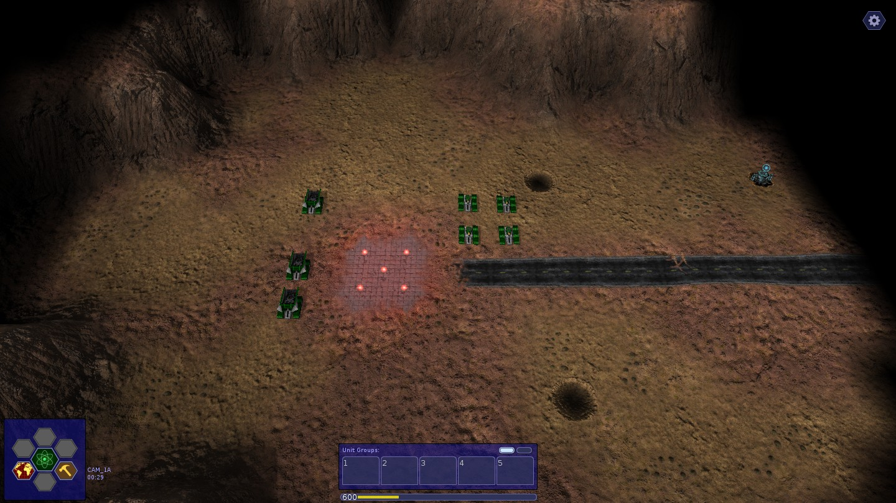
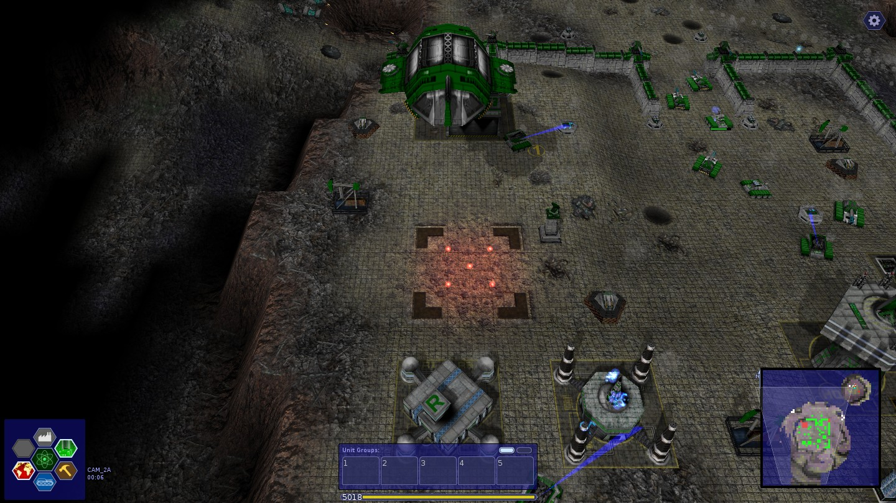
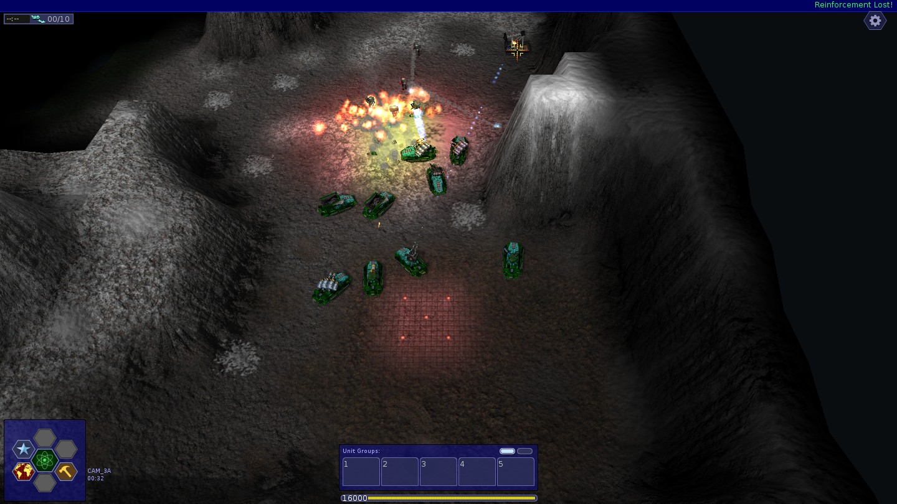
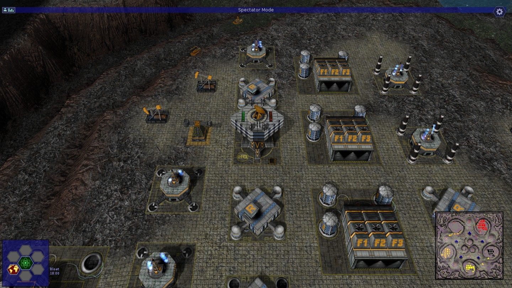

# WarzoneVB

**Warzone 2100 4.7.0, ported to Visual Basic 6.**

WarzoneVB is a statement-by-statement port of the real-time strategy game
[Warzone 2100](https://wz2100.net/) (version 4.7.0) from C and C++ to Visual Basic 6. It runs the game's own
data: the three campaigns, skirmishes against the game's AIs, and multiplayer, including games with the official
4.7.0 build.

It is an unofficial port, not made or supported by the Warzone 2100 Project.

## Screenshots

<table>
  <tr>
    <td></td>
    <td></td>
  </tr>
  <tr>
    <td align="center">Campaign 1: the first mission (Arizona)</td>
    <td align="center">Campaign 2: the base (Urban)</td>
  </tr>
  <tr>
    <td></td>
    <td></td>
  </tr>
  <tr>
    <td align="center">Campaign 3: a battle in the snow (Rockies)</td>
    <td align="center">Skirmish: four AIs, an AI's base at 18 minutes</td>
  </tr>
</table>

All four use the Remastered terrain textures, in a 1440x810 window.

## What works

* **Campaigns**: all three, from the first mission to the last, with the briefing videos and the music. Saving and
  loading work anywhere.
* **Skirmish** against the game's AIs (Nexus, NullBot, BoneCrusher, Cobra). The AI and game scripts run on
  Windows' own JavaScript engine (Chakra) in place of QuickJS.
* **Multiplayer** over LAN and the internet, including games with the official 4.7.0 build on either side. Also
  the internet lobby, port mapping (UPnP, NAT-PMP, PCP), map and mod downloads, spectators and replays.
* **Graphics**: 4.7.0's OpenGL 3.3 renderer, with the Classic, Normal and Remastered terrain. Remastered's KTX2
  textures are transcoded at load time by ports of Basis Universal and zstd.
* **Display**: windowed and desktop (borderless) fullscreen.
* **Sound**: effects and positional audio, mixed in VB over waveOut; music in Opus.
* **The screens a player meets**: menus, options, key bindings, design, research, the intelligence screen, the
  Game Guide, notifications, script-generated maps.

The port is checked against the original wherever there is something to compare with:
* an official 4.7.0 replay plays back with the same synchronisation log, tick for tick;
* stats, maps, models and JSON match the real C++ code, built with g++ from 4.7.0's sources;
* the decoders (Vorbis, Opus, Theora, zlib, zstd, Basis Universal) match their reference libraries bit for bit,
  or within the libraries' own tolerances;
* screenshots are compared with the official build's: the videos' display, the terrain, the interface.

## Not ported

* Vulkan, and the Discord integration.
* The crash handler, and the script debugger.
* Translations: the game is in English.
* The JPEG encoder, and the Emscripten (web) build.
* SQLite player statistics: a JSON file is used instead.
* Basis Universal's ETC, PVRTC, ATC and HDR targets. Desktop OpenGL never needs them.

Exclusive fullscreen, which changes the display mode, is ported but has not been tested.

## How it is organised

About 350,000 lines of VB6 in some 920 files, in one executable and eight ActiveX DLLs. VB6 limits how many
names one project can hold, so 4.7.0's libraries became DLLs along their own lines:

| Project | What it holds |
|---|---|
| `WzFramework.dll` | `lib/framework`: logging, strings, files, config, JSON; PhysFS 3.2.0 with its zip archiver |
| `WzMap.dll` | `lib/wzmaplib`, and script-generated maps |
| `WzSound.dll` | `lib/sound`: stb_vorbis, libopus 1.5.2 and opusfile, libogg; a waveOut mixer |
| `WzBasis.dll` | Basis Universal's KTX2 / UASTC transcoder and zstd 1.4.9's decoder |
| `WzGfx.dll` | `lib/ivis_opengl`: gfx_api, the OpenGL backend, models, textures, text |
| `WzNet.dll` | `lib/netplay`: Winsock connections, zlib streams, the crypto, port mapping (libplum), HTTP over Schannel |
| `WzPlatform.dll` | `lib/sdl`'s job, done over Win32: the window, input, display modes, cursors, the GL context |
| `WzSequence.dll` | `lib/sequence`: the videos, with libtheora 1.2.0's decoder |
| `Warzone.exe` | the game itself (`src/`), `lib/gamelib`, `lib/widget`, and the scripts' API over Chakra |

The sources are in `src/`, one folder per project, plus `src/shared` (modules compiled into every project) and
the test programs' folders.

## Requirements

To play:
* Windows 10 or 11.
* A graphics driver with OpenGL 3.3.

To build:
* **Visual Basic 6.0.** `tools/build.py` finds it through `%VB6_DIR%`, its setup's registry entry, or
  `C:\Program Files (x86)\Microsoft Visual Studio\VB98`.
* **Python 3** (3.12 was used).
* **The game's data**, which is not part of this repository (below).

The test tools also use g++ (MinGW-w64), ffmpeg, and the Python packages Pillow, PyNaCl and cryptography.

## Getting the data

The data is Warzone 2100 4.7.0's own. Put these under `ref/`:

| Path | What | From |
|---|---|---|
| `ref/warzone2100` | 4.7.0's source tree; its `data` folder is the game's data | the `4.7.0` tag of [Warzone2100/warzone2100](https://github.com/Warzone2100/warzone2100) |
| `ref/official/wz470` | the official 4.7.0 Windows build, unpacked (`ref/official/wz470/bin/warzone2100.exe`) | `warzone2100_win_x64_archive.zip` from the [4.7.0 release](https://github.com/Warzone2100/warzone2100/releases/tag/4.7.0) |
| `ref/videos/low-quality-en-sequences.wz` | the campaign videos | the v3 release of [Warzone2100/wz-sequences](https://github.com/Warzone2100/wz-sequences/releases) |

From the official build `tools/setup_data.py` takes:
* the music;
* the campaign mods;
* the Classic and Remastered terrain packs;
* the 39 textures that 4.7.0's build ships as KTX2.

It then makes `data/`, the folder the game reads, as hard links. Nothing is copied twice.

The other folders in `ref/` are the upstream sources the ports follow (Basis Universal, libplum, PhysFS, libogg,
libopus, libtheora, stb_vorbis, miniz). Only the tests need them.

## Building and running

```
python -I tools\setup_data.py
python -I tools\build.py
Warzone.cmd
```

* `Warzone.cmd`, in the root, starts `bin\Warzone.exe` wherever the folder is, and passes its arguments on.

* `build.py` builds the eight DLLs, then `Warzone.exe`, into `bin\`.
* `bin\` runs without registering anything: the exe carries a manifest naming its DLLs' classes. VB6 registers
  each DLL it compiles anyway; `python -I tools\build.py --unregister` removes those entries.
* `bin\Warzone.exe` keeps its settings, saves and logs in the same folder as an installed official 4.7.0
  (`%APPDATA%\Warzone 2100 Project`). To keep them apart, start it with `--configdir=<folder>`; the folder must
  exist.
* `python -I tools\package.py --zip` makes a copy to give to other people: `dist\WarzoneVB-<date>\` holds the
  game, the data, a `Play.cmd` that keeps the settings beside the game, the licences and the source.

## Tests

`python -I tools\run_tests.py` runs the main suite:
* the port's output against the real C++;
* the official replay;
* the sound, video, compression, crypto, network and texture decoders.

More tests drive the game itself through UI scripts: the menus, the campaigns, LAN games between two copies,
the lobby against a local mock, the Remastered terrain against the official build. Each is listed in the Tools
section of [docs/PLAN.md](docs/PLAN.md).

## Documentation

* [docs/PLAN.md](docs/PLAN.md): the plan and its measurements, and what each part of the port did and found
  along the way.
* [docs/CONVENTIONS.md](docs/CONVENTIONS.md): how C and C++ map to VB6 in this port, and the pitfalls met on the way.

## Licence

The port is licensed under the
[GNU General Public License, version 2 or later](https://www.gnu.org/licenses/old-licenses/gpl-2.0.html), like
Warzone 2100 itself. Some parts are ports of other libraries and keep those libraries' licences:

| Code | Licence | Where |
|---|---|---|
| libplum | Mozilla Public License 2.0 | `src/net/plum_*` |
| Basis Universal's transcoder | Apache License 2.0 | `src/basis` (`basisu_*`, `ktx2_*`, `BasisApi`) |
| zstd's decoder | BSD | `src/basis/zstd_*` |
| PhysFS | zlib licence | `src/framework/physfs_win.bas`, `physfs_zip_c.bas` |
| libogg, libtheora, libopus, opusfile | BSD | `src/shared/ogg`, `src/sequence`, `src/sound` |
| stb_vorbis | MIT or public domain | `src/sound/stb_vorbis_c.bas` |
| miniz | public domain (Unlicense) | `src/shared/miniz` |
| nlohmann/json | MIT | `src/framework/json_hpp.bas`, `nlohmann_json.cls` |
| inih | BSD | `src/game/ini_c.bas` |
| libsodium's functions, on TweetNaCl's arithmetic | ISC (libsodium), public domain (TweetNaCl) | `src/shared/sodium` |

Warzone 2100's data is not part of this repository. Its licences are in 4.7.0's `COPYING`, `COPYING.NONGPL`
and `COPYING.README`.
